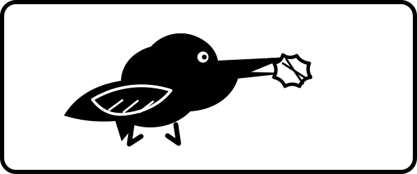

  

# Crow Foodie
*created in 2023 by [Daniel McKeown](https://altaredwood.work)*

- this game is for the [PlayDate](https://play.date/) platform made using the [Pulp](https://play.date/pulp/) tool
- this code is what is contained inside the Pulp export artifact `IDFMEJOLZPCrow-Foodie_20261105212227.zip`; when extracted, it contains a file named `Crow-Foodie.pdx`
- also included is a Pulp "full game" export file `Crow Foodie.json`
- this version was known as "version 2" of the Crow Foodie game
- the game is about being a crow trying out tasty snacks